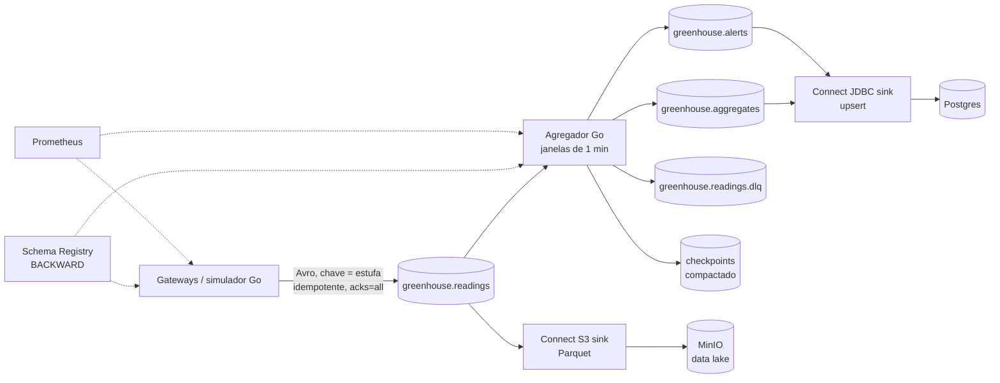

# kafka-telemetry


Pipeline de telemetria com Kafka para os sensores das estufas da cooperativa fictícia **AgroVale Exemplo**: leituras de temperatura, umidade, CO2 e luminosidade viram agregados de 1 minuto, alertas de limite, um histórico consultável no Postgres e um data lake em Parquet, com contratos de schema versionados e sem perder nem duplicar dados.

## O problema

Cada estufa da AgroVale Exemplo tem quatro sensores ligados a um gateway. Hoje os dados ficam no gateway e só são olhados depois que a colheita foi afetada: um ventilador parado às 14h de um dia quente é descoberto no dia seguinte, com a alface queimada. A cooperativa quer:

- ver cada estufa minuto a minuto (média, mínimo e máximo de cada grandeza);
- ser avisada quando a temperatura, a umidade, o CO2 ou a luz saem da faixa agronômica;
- guardar todo o histórico bruto para o agrônomo analisar e, no futuro, treinar modelos;
- confiar nos números: retransmissões dos gateways e quedas do sistema não podem duplicar nem apagar leituras.

## Arquitetura



- **Simulador** (`cmd/simulator`): N estufas × 4 sensores, taxa configurável, com estufas superaquecidas, retransmissões e leituras inválidas para exercitar alertas, deduplicação e DLQ.
- **Agregador** (`cmd/aggregator`): janelas tumbling de 1 minuto por estufa e grandeza em tempo de evento, deduplicação por `event_id`, alertas, DLQ e commit manual de offset depois do processamento.
- **Kafka Connect**: sink JDBC com upsert para o Postgres e sink S3 em Parquet para o MinIO, ambos versionados em `connect/`.
- **telemetryctl**: cria tópicos e registra os schemas com compatibilidade BACKWARD.

Detalhes em [docs/design-doc.md](docs/design-doc.md).

## Núcleo

| Tema | Onde | Roteiro |
| --- | --- | --- |
| Contratos de schema: Avro versionado, BACKWARD no registry, portão BACKWARD_TRANSITIVE no CI | `schemas/`, `internal/contract` | [docs/roteiros/contratos-de-schema.md](docs/roteiros/contratos-de-schema.md) |
| Garantias de entrega: produtor idempotente, offset seguro, publish → checkpoint → commit, dedup, DLQ | `internal/telemetry`, `internal/aggregation`, `internal/kafka` | [docs/roteiros/garantias-de-entrega.md](docs/roteiros/garantias-de-entrega.md) |

## Como rodar

Pré-requisitos: Docker com Compose v2, Go 1.26+ e `make`. O ambiente completo usa cerca de 4 GB de memória.

```bash
cp .env.example .env        # opcional: ajuste portas e taxa do simulador
make up                     # núcleo + observabilidade (build das imagens na primeira vez)
make ps                     # todos os serviços de infraestrutura devem ficar healthy
make logs SERVICE=aggregator
```

O serviço `init` cria os tópicos e registra os schemas; `connectors` aplica os conectores. Depois de cerca de 1 minuto:

```bash
# Agregados e alertas no Postgres
docker compose exec postgres psql -U telemetry -d telemetry \
  -c "SELECT greenhouse_id, sensor_type, window_start, sample_count, round(mean_value::numeric, 2) AS media FROM greenhouse_window_aggregates ORDER BY window_start DESC LIMIT 8;" \
  -c "SELECT greenhouse_id, sensor_type, rule, round(observed_value::numeric, 1) AS observado, limit_value FROM greenhouse_alerts LIMIT 5;"

# Estado dos conectores e arquivos Parquet no data lake
curl -s localhost:8083/connectors?expand=status | jq '.[].status.connector.state'
docker compose exec minio mc ls --recursive local/agrovale-telemetry-raw | head
```

| Interface | Endereço |
| --- | --- |
| Métricas do simulador / agregador | http://localhost:9101/metrics, http://localhost:9102/metrics |
| Prometheus | http://localhost:9090 |
| Jaeger (com `OTEL_EXPORTER_OTLP_ENDPOINT=http://jaeger:4318`) | http://localhost:16686 |
| Console do MinIO (`dev-only-minio` / `dev-only-change-me`) | http://localhost:9001 |
| Kafka UI (`make up-tools`) | http://localhost:8080 |

Outros alvos: `make seed` (reaplica tópicos, schemas e conectores e injeta 30 s de leituras), `make down`, `make clean` (remove volumes), `make up-portfolio` (liga à rede compartilhada `portfolio-net` do ecossistema).

Sem Docker, os binários rodam contra qualquer Kafka + Schema Registry:

```bash
export KAFKA_BROKERS=localhost:9092 SCHEMA_REGISTRY_URL=http://localhost:8081
go run ./cmd/telemetryctl init
go run ./cmd/aggregator &
go run ./cmd/simulator -greenhouses 50 -rate 500 -duration 2m
```

## Como testar

```bash
make test               # unitários com -race e cobertura
make test-integration   # Redpanda via testcontainers (pula sem Docker)
make schemas-check      # portão de compatibilidade dos schemas, sem rede
make lint               # gofmt, go vet e golangci-lint
make loadtest LOAD_RATE=2000 LOAD_DURATION=60s LOAD_GREENHOUSES=200
```

O que os testes cobrem:

- **Domínio**: validação de leituras (faixas físicas, relógio adiantado, NaN), janelas por estufa e grandeza, tolerância a atraso, deduplicação, offset seguro e replay determinístico a partir do checkpoint.
- **Contratos**: formato de fio, leitura de mensagens v1 com o leitor v2, cache de schema, classificação de erros (definitivo versus transitório) e os casos de mudança de schema (campo opcional passa; obrigatório novo e troca de tipo falham; remoção passa em BACKWARD e falha em FORWARD).
- **Caso de uso**: ordem publish → checkpoint → commit, DLQ por motivo, falha de publish e de checkpoint sem commit, retry do registry sem DLQ, restart sem reemitir janelas.
- **Integração**: registry real concordando com o portão local e pipeline ponta a ponta com crash e restart.

Resultado do teste de carga e métricas observadas: [docs/teste-de-carga.md](docs/teste-de-carga.md).

## Decisões principais

| ADR | Decisão |
| --- | --- |
| [0001](docs/adr/0001-avro-com-schema-registry.md) | Avro com Schema Registry |
| [0002](docs/adr/0002-cliente-franz-go.md) | franz-go como cliente Kafka (Go puro) |
| [0003](docs/adr/0003-at-least-once-com-idempotencia.md) | At-least-once com idempotência e checkpoint, em vez de EOS transacional |
| [0004](docs/adr/0004-compatibilidade-backward.md) | BACKWARD no registry, BACKWARD_TRANSITIVE no CI |
| [0005](docs/adr/0005-janelas-por-tempo-de-evento.md) | Janelas por tempo de evento com watermark por partição |
| [0006](docs/adr/0006-kafka-kraft-e-redpanda-nos-testes.md) | Kafka KRaft no compose, Redpanda nos testes |
| [0007](docs/adr/0007-data-lake-no-minio-com-s3-sink.md) | Data lake no MinIO com S3 sink em Parquet |
| [0008](docs/adr/0008-sink-jdbc-upsert-no-postgres.md) | Sink JDBC com upsert no Postgres |

## Trade-offs

- **Duplicatas no tópico de agregados são possíveis** (crash entre publish e commit), mas idênticas; o efeito exatamente uma vez acontece no destino, pelo upsert. Em troca, sem transações, a latência é menor e o desenho vale para qualquer destino.
- **O offset commitado fica para trás** do processado (até o início da janela aberta mais antiga): um restart reprocessa cerca de 1 minuto por partição.
- **Leituras com mais de 10 s de atraso são descartadas** e contadas, não corrigem o agregado já emitido.
- **Alertas pela média da janela** evitam falso alarme por pico isolado, ao custo de até ~70 s de latência.
- **O registry está no caminho de leitura**; cache e retry sem DLQ seguram indisponibilidades curtas.
- **Watermark por partição**: uma partição sem tráfego segura suas janelas.

## Próximos passos

- Watermark ocioso (por tempo de processamento) e watermark por estufa.
- Reprocessador da DLQ e consumidor de alertas que notifica o produtor rural.
- SASL/mTLS, ACLs por serviço e registry autenticado.
- Dashboards Grafana versionados e SLOs de lag e latência.
- Teste de carga noturno no CI com limiar de regressão.
- Deploy em Kubernetes com autoscaling pelo lag.

## Estrutura

```
cmd/            simulator, aggregator, telemetryctl
internal/
  telemetry/    domínio puro: leitura, janelas, watermark, dedup, limites
  contract/     formato de fio, codec Avro, compatibilidade, registros
  aggregation/  caso de uso e portas (publish -> checkpoint -> commit)
  kafka/        adaptadores franz-go e Schema Registry
  simulator/    gerador de leituras
  observability/ métricas, logs, tracing
schemas/        contratos Avro versionados + fixtures de mudanças incompatíveis
connect/        imagem do Connect e conectores JDBC e S3
deploy/         Postgres (DDL) e Prometheus (scrape e alertas)
docs/           design doc, ADRs, roteiros, observabilidade, teste de carga
```

## Cursos exercitados

Apache Kafka (tempo real, Kafka Connect, Schema Registry), Testes avançados (carga, integridade de dados), DDD e arquitetura baseada em eventos, Tech Metrics (métricas DORA e SLIs em [docs/observabilidade.md](docs/observabilidade.md)).

## Licença

[MIT](LICENSE)
