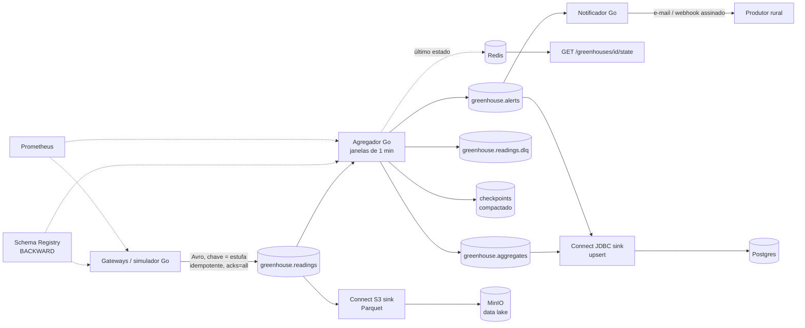

# kafka-telemetry


Pipeline de telemetria com Kafka para os sensores das estufas da cooperativa fictícia **AgroVale Exemplo**: leituras de temperatura, umidade, CO2 e luminosidade viram agregados de 1 minuto, alertas de limite, um histórico consultável no Postgres e um data lake em Parquet, com contratos de schema versionados e sem perder nem duplicar dados.

## O problema

Cada estufa da AgroVale Exemplo tem quatro sensores ligados a um gateway. Hoje os dados ficam no gateway e só são olhados depois que a colheita foi afetada: um ventilador parado às 14h de um dia quente é descoberto no dia seguinte, com a alface queimada. A cooperativa quer:

- ver cada estufa minuto a minuto (média, mínimo e máximo de cada grandeza);
- ser avisada quando a temperatura, a umidade, o CO2 ou a luz saem da faixa agronômica;
- guardar todo o histórico bruto para o agrônomo analisar e, no futuro, treinar modelos;
- confiar nos números: retransmissões dos gateways e quedas do sistema não podem duplicar nem apagar leituras.

## Arquitetura



- **Simulador** (`cmd/simulator`): N estufas × 4 sensores, taxa configurável, com estufas superaquecidas, retransmissões e leituras inválidas para exercitar alertas, deduplicação e DLQ.
- **Agregador** (`cmd/aggregator`): janelas tumbling de 1 minuto por estufa e grandeza em tempo de evento, deduplicação por `event_id`, alertas, DLQ e commit manual de offset depois do processamento.
- **Notificador** (`cmd/notifier`): consome os alertas e avisa o produtor rural por e-mail (Mailpit no compose, UI em http://127.0.0.1:8025) e por webhook assinado com HMAC-SHA256 (um segredo por produtor, vindo de variável de ambiente), com idempotência no Redis e retry em dois níveis (rápido e fila durável com idade máxima) ([ADR 0013](docs/adr/0013-notificador-de-alertas.md)). Os produtores e suas estufas vêm de `deploy/notifier/recipients.json`. Os adaptadores foram testados contra um SMTP local de teste e receptores HTTP locais; o Mailpit do compose só foi validado com `docker compose config`; **nada foi exercitado contra um provedor real de e-mail nem um receptor de terceiros**.
- **Kafka Connect**: sink JDBC com upsert para o Postgres e sink S3 em Parquet para o MinIO, ambos versionados em `connect/`.
- **telemetryctl**: cria tópicos e registra os schemas com compatibilidade BACKWARD.

Detalhes em [docs/design-doc.md](docs/design-doc.md); padrões e SOLID com o trecho de código de cada um em [docs/arquitetura/padroes.md](docs/arquitetura/padroes.md).

## Núcleo

| Tema | Onde | Roteiro |
| --- | --- | --- |
| Contratos de schema: Avro versionado, BACKWARD no registry, portão BACKWARD_TRANSITIVE no CI | `schemas/`, `internal/contract` | [docs/roteiros/contratos-de-schema.md](docs/roteiros/contratos-de-schema.md) |
| Garantias de entrega: produtor idempotente, offset seguro, publish → checkpoint → commit, dedup, DLQ | `internal/telemetry`, `internal/aggregation`, `internal/kafka` | [docs/roteiros/garantias-de-entrega.md](docs/roteiros/garantias-de-entrega.md) |

## Como rodar

Pré-requisitos: Docker com Compose v2, Go 1.26+ e `make`. O ambiente completo usa cerca de 4 GB de memória.

```bash
cp .env.example .env        # opcional: ajuste portas e taxa do simulador
make up                     # núcleo + observabilidade (build das imagens na primeira vez)
make ps                     # todos os serviços de infraestrutura devem ficar healthy
make logs SERVICE=aggregator
```

O serviço `init` cria os tópicos e registra os schemas; `connectors` aplica os conectores. Depois de cerca de 1 minuto:

```bash
# Agregados e alertas no Postgres
docker compose exec postgres psql -U telemetry -d telemetry \
  -c "SELECT greenhouse_id, sensor_type, window_start, sample_count, round(mean_value::numeric, 2) AS media FROM greenhouse_window_aggregates ORDER BY window_start DESC LIMIT 8;" \
  -c "SELECT greenhouse_id, sensor_type, rule, round(observed_value::numeric, 1) AS observado, limit_value FROM greenhouse_alerts LIMIT 5;"

# Estado dos conectores e arquivos Parquet no data lake
curl -s localhost:8083/connectors?expand=status | jq '.[].status.connector.state'
docker compose exec minio mc ls --recursive local/agrovale-telemetry-raw | head
```

| Interface | Endereço |
| --- | --- |
| Métricas do simulador / agregador / notificador | http://localhost:9101/metrics, http://localhost:9102/metrics, http://127.0.0.1:9103/metrics |
| Mailpit, com os e-mails de alerta (só loopback) | http://127.0.0.1:8025 |
| Prometheus | http://localhost:9090 |
| Jaeger (com `OTEL_EXPORTER_OTLP_ENDPOINT=http://jaeger:4318`) | http://localhost:16686 |
| Console do MinIO (`dev-only-minio` / `dev-only-change-me`) | http://localhost:9001 |
| Kafka UI (`make up-tools`) | http://localhost:8080 |
| Último estado de uma estufa (Redis) | http://localhost:9102/greenhouses/gh-001/state |

Outros alvos: `make seed` (reaplica tópicos, schemas e conectores e injeta 30 s de leituras), `make down`, `make clean` (remove volumes), `make up-portfolio` (liga à rede compartilhada `portfolio-net` do ecossistema).

Sem Docker, os binários rodam contra qualquer Kafka + Schema Registry:

```bash
export KAFKA_BROKERS=localhost:9092 SCHEMA_REGISTRY_URL=http://localhost:8081
go run ./cmd/telemetryctl init
go run ./cmd/aggregator &
go run ./cmd/simulator -greenhouses 50 -rate 500 -duration 2m
```

## Evidência

Um vídeo gravado com Playwright percorre o fluxo principal com a stack real: tópicos e schemas (BACKWARD), leituras particionadas por estufa na Kafka UI, agregados no tópico e no Postgres, alerta, DLQ com o motivo no header, retransmissão deduplicada, último estado no Redis, schema incompatível recusado pelo registry, lag e throughput no Prometheus e Parquet no MinIO.

```bash
make evidencia   # sobe tudo (simulador a 400 leituras/s), espera os conectores e roda e2e/evidencia
```

O vídeo fica em `e2e/evidencia/test-results/`. Se alguma porta estiver ocupada, exporte a variável correspondente de `.env.example` (ex.: `AGGREGATOR_METRICS_PORT=9112`) antes do comando.

## API de consulta

O agregador serve estado, séries, alertas com reconhecimento, DLQ, faixas agronômicas (configuráveis), saúde do pipeline e o reprocessamento da DLQ (dry-run por padrão; só recupera leituras de janela ainda aberta, as de janela fechada ficam como `would_be_late` e são recuperadas pelo modo `backfill`, que recalcula o agregado da janela com upsert idempotente por `event_id`; `telemetryctl dlq replay` faz o mesmo) na porta `AGGREGATOR_METRICS_PORT` (9102). Referência completa em [docs/api.md](docs/api.md).

## Perfil seguro (TLS, mTLS, SASL, ACLs e registry autenticado)

```bash
make secure-init   # gera CA, certificados, senhas e JAAS em .secure/ (fora do git)
make up-secure     # Kafka com SASL_SSL e mTLS, ACLs por serviço, registry HTTPS com login, simulador, agregador e notificador
```

Decisão e limites no [ADR 0016](docs/adr/0016-perfil-seguro-tls-sasl-acls.md). Cada serviço monta só o diretório do próprio principal (`.secure/<serviço>`), e nada gerado vai para o Git. O job `secure-profile` do CI sobe o perfil e prova o caminho simulador até agregador e as negações (ACLs, mTLS, senha SASL, registry sem senha); **nesta máquina só rodaram o gerador, os testes do cliente, o teste de higiene e `compose config`**, então o resultado do CI é a prova. O Connect, o MinIO e a web ficam fora dele. O basic auth do registry autentica mas não separa leitura de escrita.

## Como testar

```bash
make test               # unitários com -race e cobertura
make test-integration   # Redpanda via testcontainers (pula sem Docker)
make schemas-check      # portão de compatibilidade dos schemas, sem rede
make lint               # gofmt, go vet e golangci-lint
make loadtest LOAD_RATE=2000 LOAD_DURATION=60s LOAD_GREENHOUSES=200
```

O que os testes cobrem:

- **Domínio**: validação de leituras (faixas físicas, relógio adiantado, NaN), janelas por estufa e grandeza, tolerância a atraso, deduplicação, offset seguro e replay determinístico a partir do checkpoint.
- **Contratos**: formato de fio, leitura de mensagens v1 com o leitor v2, cache de schema, classificação de erros (definitivo versus transitório) e os casos de mudança de schema (campo opcional passa; obrigatório novo e troca de tipo falham; remoção passa em BACKWARD e falha em FORWARD).
- **Caso de uso**: ordem publish → checkpoint → commit, DLQ por motivo, falha de publish e de checkpoint sem commit, retry do registry sem DLQ, restart sem reemitir janelas.
- **Integração**: registry real concordando com o portão local e pipeline ponta a ponta com crash e restart.

Resultado do teste de carga e métricas observadas: [docs/teste-de-carga.md](docs/teste-de-carga.md).

## Decisões principais

| ADR | Decisão |
| --- | --- |
| [0001](docs/adr/0001-avro-com-schema-registry.md) | Avro com Schema Registry |
| [0002](docs/adr/0002-cliente-franz-go.md) | franz-go como cliente Kafka (Go puro) |
| [0003](docs/adr/0003-at-least-once-com-idempotencia.md) | At-least-once com idempotência e checkpoint, em vez de EOS transacional |
| [0004](docs/adr/0004-compatibilidade-backward.md) | BACKWARD no registry, BACKWARD_TRANSITIVE no CI |
| [0005](docs/adr/0005-janelas-por-tempo-de-evento.md) | Janelas por tempo de evento com watermark (por partição; por estufa desde o 0014) |
| [0006](docs/adr/0006-kafka-kraft-e-redpanda-nos-testes.md) | Kafka KRaft no compose, Redpanda nos testes |
| [0007](docs/adr/0007-data-lake-no-minio-com-s3-sink.md) | Data lake no MinIO com S3 sink em Parquet |
| [0008](docs/adr/0008-sink-jdbc-upsert-no-postgres.md) | Sink JDBC com upsert no Postgres |
| [0009](docs/adr/0009-ultimo-estado-no-redis.md) | Último estado de cada estufa no Redis, fora da garantia de entrega |
| [0010](docs/adr/0010-api-de-consulta-no-agregador.md) | API de consulta no processo do agregador |
| [0011](docs/adr/0011-autenticacao-de-operador-na-api.md) | Autenticação de operador por token e autoria no reconhecimento |
| [0012](docs/adr/0012-reprocessador-da-dlq.md) | Reprocessador da DLQ: destino fixo, dry-run, ledger e autoria |
| [0013](docs/adr/0013-notificador-de-alertas.md) | Notificador de alertas: e-mail e webhook assinado, idempotência e retry |
| [0016](docs/adr/0016-perfil-seguro-tls-sasl-acls.md) | Perfil seguro: TLS, mTLS, SASL, ACLs por serviço e registry autenticado |
| [0015](docs/adr/0015-backfill-de-janelas-fechadas.md) | Backfill de janelas fechadas: recalcula o agregado, idempotente por `event_id` |
| [0014](docs/adr/0014-watermark-por-estufa-e-ocioso.md) | Watermark por estufa e fechamento ocioso por tempo de processamento |

## Trade-offs

- **Duplicatas no tópico de agregados são possíveis** (crash entre publish e commit), mas idênticas; o efeito exatamente uma vez acontece no destino, pelo upsert. Em troca, sem transações, a latência é menor e o desenho vale para qualquer destino.
- **O offset commitado fica para trás** do processado (até o início da janela aberta mais antiga): um restart reprocessa cerca de 1 minuto por partição.
- **Leituras com mais de 10 s de atraso são descartadas** e contadas, não corrigem o agregado já emitido.
- **Alertas pela média da janela** evitam falso alarme por pico isolado, ao custo de até ~70 s de latência.
- **O registry está no caminho de leitura**; cache e retry sem DLQ seguram indisponibilidades curtas.
- **Watermark por estufa com fechamento ocioso**: uma estufa calada só tem as janelas fechadas depois de `WATERMARK_IDLE_TIMEOUT` (2 min), e uma leitura reenviada depois disso é descartada como atrasada ([ADR 0014](docs/adr/0014-watermark-por-estufa-e-ocioso.md)).

## Próximos passos

- Rodar `make loadtest` numa máquina dedicada e registrar as métricas em [docs/teste-de-carga.md](docs/teste-de-carga.md) (a rodada formal foi adiada para economizar recursos).
- Cadastro de produtores fora de arquivo ([ADR 0013](docs/adr/0013-notificador-de-alertas.md)).
- Extrair a API para um `cmd/api` se a carga de leitura crescer. A autenticação por token de operador e a autoria do reconhecimento de alertas já existem ([ADR 0011](docs/adr/0011-autenticacao-de-operador-na-api.md)).
- Executar o perfil seguro contra um broker real, incluir o Connect nele e separar leitura de escrita no registry ([ADR 0016](docs/adr/0016-perfil-seguro-tls-sasl-acls.md)).
- Dashboards Grafana versionados e SLOs de lag e latência.
- Teste de carga noturno no CI com limiar de regressão.
- Deploy em Kubernetes com autoscaling pelo lag.

## Estrutura

```
cmd/            simulator, aggregator, notifier, telemetryctl
internal/
  telemetry/    domínio puro: leitura, janelas, watermark, dedup, limites
  contract/     formato de fio, codec Avro, compatibilidade, registros
  aggregation/  caso de uso e portas (publish -> checkpoint -> commit)
  kafka/        adaptadores franz-go e Schema Registry
  simulator/    gerador de leituras
  observability/ métricas, logs, tracing
  state/        último estado por estufa no Redis e endpoint de leitura
  api/          adaptador HTTP de consulta (estado, séries, alertas, DLQ, saúde)
  dlq/          reprocessador da DLQ (ledger no Redis)
  notify/       notificador de alertas (canais, idempotência, retry)
  postgres/     séries e alertas com reconhecimento
  alerting/ history/ pipeline/  modelos e portas da API
schemas/        contratos Avro versionados + fixtures de mudanças incompatíveis
connect/        imagem do Connect e conectores JDBC e S3
deploy/         Postgres (DDL) e Prometheus (scrape e alertas)
docs/           design doc, ADRs, padrões, roteiros, observabilidade, teste de carga
e2e/evidencia/  evidência em vídeo com Playwright
```

## Cursos exercitados

Apache Kafka (tempo real, Kafka Connect, Schema Registry), Testes avançados (carga, integridade de dados), DDD e arquitetura baseada em eventos, Tech Metrics (métricas DORA e SLIs em [docs/observabilidade.md](docs/observabilidade.md)).

## Licença

[MIT](LICENSE)
