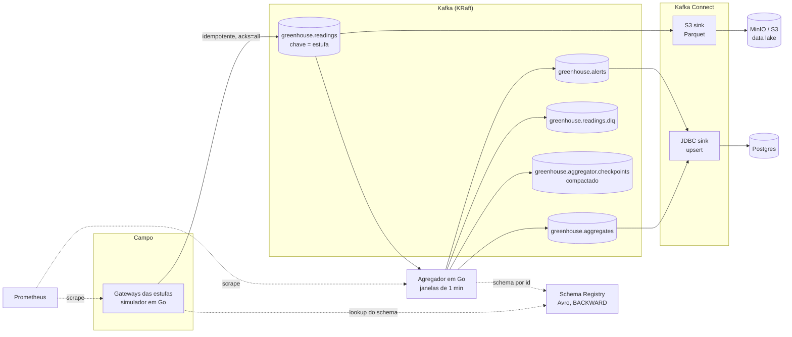
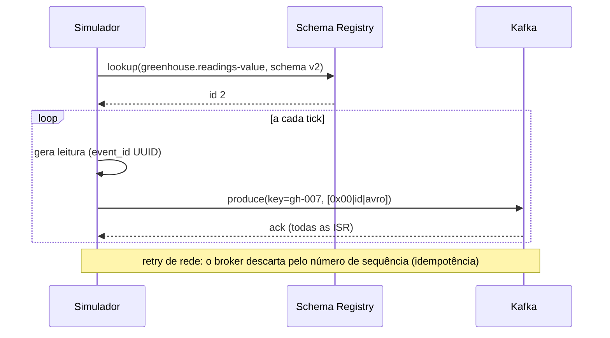
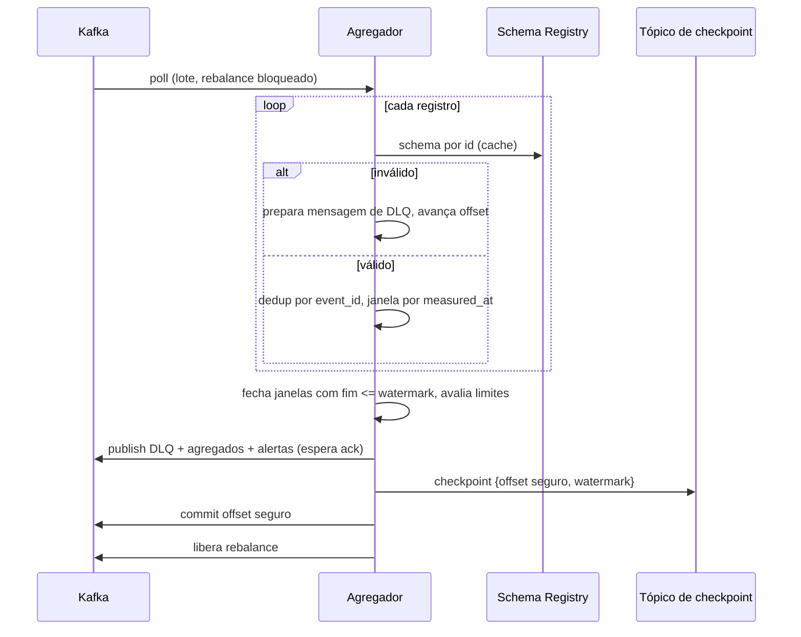
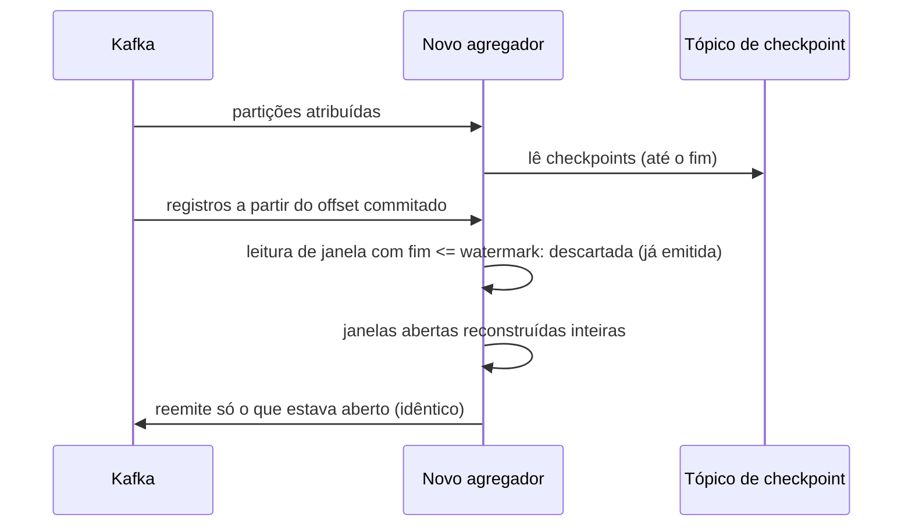

# Design doc: pipeline de telemetria das estufas

- Autor: Johnny Santos
- Status: fundação implementada
- Última revisão: 2026-11-21

## 1. Contexto

A cooperativa fictícia **AgroVale Exemplo** opera estufas de hortaliças. Cada estufa tem sensores de temperatura, umidade relativa, CO2 e luminosidade ligados a um gateway que envia uma leitura por sensor a cada poucos segundos. Hoje os dados ficam no gateway e só são olhados quando a colheita já foi afetada: um ventilador parado numa tarde de verão é descoberto no dia seguinte.

A cooperativa quer três coisas: ver a situação de cada estufa minuto a minuto, ser avisada quando uma grandeza sai da faixa agronômica e guardar o histórico bruto para análise e modelos futuros.

## 2. Objetivos

1. Ingerir leituras de dezenas a centenas de estufas, mantendo a ordem por estufa.
2. Produzir agregados de 1 minuto por estufa e grandeza (média, mínimo, máximo, contagem).
3. Emitir alertas quando a média de uma janela sai do limite agronômico.
4. Nenhuma leitura válida perdida e nenhum agregado duplicado ou parcial no banco, mesmo com crash, rebalance ou retransmissão (ver [roteiro de garantias](roteiros/garantias-de-entrega.md)).
5. Contratos de mensagem versionados que impedem mudanças que quebrem consumidores (ver [roteiro de contratos](roteiros/contratos-de-schema.md)).
6. Isolar mensagens inválidas numa DLQ sem bloquear o fluxo.
7. Expor métricas de lag, throughput e latência para operar o pipeline.

## 3. Não objetivos (nesta fundação)

- Painel visual para o produtor rural (os dados ficam prontos no Postgres).
- Notificação ativa do alerta (SMS, push); o alerta é publicado num tópico.
- Comando de atuadores (abrir janela, ligar irrigação).
- Autenticação dos gateways e TLS/SASL no Kafka (ver Segurança).
- Multi-região e alta disponibilidade do ambiente local.

## 4. Arquitetura

### Componentes

| Componente | Responsabilidade | Código |
| --- | --- | --- |
| Simulador | Gera leituras plausíveis (ciclo diário, ruído, estufas anômalas, duplicatas e inválidas configuráveis) e publica com produtor idempotente | `cmd/simulator`, `internal/simulator` |
| Domínio | Leitura e validação, janelas, watermark, deduplicação, offset seguro, limites e alertas. Puro, sem I/O | `internal/telemetry` |
| Contratos | Formato de fio do registry, codec Avro com cache, checagem de compatibilidade, registros dos tópicos | `internal/contract`, `schemas/` |
| Caso de uso de agregação | Orquestra decodificação, janelas, DLQ, publicação, checkpoint e commit por portas | `internal/aggregation` |
| Adaptadores Kafka | Produtor, consumidor em grupo, checkpoint store, admin de tópicos, cliente do registry (franz-go) | `internal/kafka` |
| Observabilidade | Métricas Prometheus, logs JSON, tracing OpenTelemetry | `internal/observability` |
| telemetryctl | Cria tópicos, confere e registra schemas | `cmd/telemetryctl` |
| Kafka Connect | Sinks JDBC (Postgres) e S3 (MinIO), configuração versionada | `connect/` |

A arquitetura é hexagonal: `internal/telemetry` não importa nada de infraestrutura; `internal/aggregation` define as portas (`Publisher`, `CheckpointStore`, `Committer`, `Decoder`, `Encoder`, `Observer`) e é testado inteiro em memória; `internal/kafka` implementa as portas.

## 5. Modelo de dados

### Tópicos

| Tópico | Chave | Valor | Partições | Retenção | Observação |
| --- | --- | --- | --- | --- | --- |
| `greenhouse.readings` | `greenhouse_id` | `SensorReading` (v2) | 6 | 7 dias | Ordem por estufa |
| `greenhouse.aggregates` | `greenhouse_id` | `WindowAggregate` | 6 | 30 dias | Fonte do sink JDBC |
| `greenhouse.alerts` | `greenhouse_id` | `ThresholdAlert` | 6 | 30 dias | `alert_id` determinístico |
| `greenhouse.readings.dlq` | original | bytes originais | 1 | 30 dias | Headers `dlq.*` |
| `greenhouse.aggregator.checkpoints` | `<tópico>/<partição>` | JSON `{offset, watermark_ms}` | 1 | compactado | Estado mínimo do agregador |

### Schemas (Avro, `schemas/avro/`)

- `SensorReading`: `event_id` (uuid), `greenhouse_id`, `sensor_id`, `sensor_type` (enum com default `UNKNOWN`), `value`, `unit`, `measured_at` (timestamp-millis); v2 adiciona `firmware_version` opcional.
- `WindowAggregate`: `greenhouse_id`, `sensor_type`, `window_start`, `window_end`, `sample_count`, `min_value`, `max_value`, `mean_value`, `unit`.
- `ThresholdAlert`: `alert_id`, `greenhouse_id`, `sensor_type`, `window_start`, `window_end`, `rule` (`ABOVE_MAX`/`BELOW_MIN`), `observed_value`, `limit_value`.

### Postgres (`deploy/postgres/init.sql`)

- `greenhouse_window_aggregates`, PK `(greenhouse_id, sensor_type, window_start)`.
- `greenhouse_alerts`, PK `alert_id`.

### Data lake

`s3://agrovale-telemetry-raw/raw/greenhouse.readings/year=YYYY/month=MM/day=dd/hour=HH/*.snappy.parquet`.

### Regras de domínio

| Regra | Valor |
| --- | --- |
| Faixa física (fora dela: DLQ) | temperatura −40 a 85 °C; umidade 0 a 100 %; CO2 0 a 10.000 ppm; luminosidade 0 a 200.000 lux |
| Relógio adiantado tolerado | 5 min |
| Limites agronômicos (média da janela) | temperatura 12 a 32 °C; umidade 50 a 90 %; CO2 350 a 1.500 ppm; luminosidade até 80.000 lux |
| Janela | tumbling de 1 min, tempo de evento |
| Tolerância a atraso | 10 s |

## 6. Fluxos principais

### 6.1 Produção de uma leitura

### 6.2 Processamento de um lote

### 6.3 Restart depois de crash

### 6.4 Materialização

O JDBC sink consome agregados e alertas e faz upsert no Postgres. O S3 sink consome as leituras brutas e grava Parquet no MinIO a cada 5.000 registros ou 60 s.

## 7. Falhas e como são tratadas

| Falha | Tratamento | Efeito visível |
| --- | --- | --- |
| Broker indisponível ou troca de líder | Produtor idempotente faz retry sem duplicar; consumidor ignora erros retentáveis e continua | Latência sobe; nada se perde |
| Mensagem não Avro / truncada | DLQ `malformed` com bytes e origem | Métrica `dead_letters_total{reason}` |
| Id de schema inexistente | DLQ `unknown_schema` | Idem |
| Leitura fora da faixa física | DLQ `invalid_reading` | Idem |
| Schema Registry fora do ar | Retry com backoff exponencial (até 5 s) bloqueando a partição; nada vai para a DLQ | Lag sobe; alerta `AggregatorStalled` |
| Retransmissão do gateway | Dedup por `event_id` | `records_total{outcome="duplicate"}` |
| Leitura atrasada além de 10 s | Descartada | `records_total{outcome="late"}` |
| Crash entre publish e commit | Restart reemite agregados idênticos; upsert absorve | Nenhum no banco |
| Falha ao publicar ou gravar checkpoint | Processo encerra sem commit (fail-fast); o orquestrador reinicia | Reprocessa no máximo ~1 min por partição |
| Rebalance | Bloqueado durante o lote; no revoke commita o offset seguro e descarta o estado | Novo dono reconstrói janelas |
| Erro de conversão no Connect | DLQ do Connect (`*.connect-dlq`) | Task continua |
| Postgres indisponível | Task do JDBC sink falha e é reiniciada; offsets do Connect não avançam | Atraso no banco, sem perda |

## 8. Segurança

- Nenhum segredo real no repositório: senhas de desenvolvimento marcadas como `dev-only-change-me`, `.env` ignorado, `.env.example` versionado.
- Conectores não carregam senha no JSON: usam `EnvVarConfigProvider` (`${env:...}`); na nuvem, o provider aponta para um cofre (AWS Secrets Manager, Vault) e o S3 usa IAM role.
- Imagem da aplicação `distroless:nonroot`, binários estáticos.
- O ambiente local usa PLAINTEXT. Em produção: SASL/SCRAM ou mTLS nos listeners, ACLs por principal (simulador só escreve em `readings`; agregador lê `readings` e escreve nos demais), Schema Registry com autenticação e somente o pipeline de CI com permissão de registrar schemas.
- Validação de entrada no domínio (faixa física, relógio, ids obrigatórios) protege os agregados de dados corrompidos.

## 9. Observabilidade

Detalhes em [observabilidade.md](observabilidade.md).

- **Métricas** (Prometheus): lag por partição, throughput consumido e produzido, destino de cada leitura, DLQ por motivo, janelas abertas, watermark, offset commitado, latência fim a fim e de ack, duração do lote. Regras de alerta em `deploy/prometheus/alerts.yml`.
- **Logs** JSON (slog) com `service`, partição e offset nos eventos relevantes (DLQ, alerta, atribuição de partição).
- **Traces** OpenTelemetry via `kotel`: o contexto W3C viaja nos headers da mensagem, ligando o span de produce do simulador ao de consumo no agregador. Ligado só quando `OTEL_EXPORTER_OTLP_ENDPOINT` existe; amostragem por `OTEL_TRACES_SAMPLER`.

## 10. Alternativas consideradas

| Decisão | Alternativa | Por que não agora | ADR |
| --- | --- | --- | --- |
| Avro | Protobuf, JSON Schema | Integração com Connect e Parquet, resolução leitor/escritor | [0001](adr/0001-avro-com-schema-registry.md) |
| franz-go | confluent-kafka-go, Sarama | Sem cgo, controle de rebalance | [0002](adr/0002-cliente-franz-go.md) |
| At-least-once + idempotência | EOS transacional | Destino fora do Kafka, menor latência | [0003](adr/0003-at-least-once-com-idempotencia.md) |
| BACKWARD (+ transitivo no CI) | FULL, FORWARD | Consumidores atualizados antes dos gateways | [0004](adr/0004-compatibilidade-backward.md) |
| Tempo de evento + watermark por partição | Tempo de processamento, watermark por estufa | Determinismo com estado pequeno | [0005](adr/0005-janelas-por-tempo-de-evento.md) |
| Kafka KRaft no compose, Redpanda nos testes | ZooKeeper, mocks | Modo atual do Kafka; testes rápidos | [0006](adr/0006-kafka-kraft-e-redpanda-nos-testes.md) |
| MinIO + S3 sink Parquet | LocalStack, JSON | Só precisamos de S3; formato colunar | [0007](adr/0007-data-lake-no-minio-com-s3-sink.md) |
| JDBC sink com upsert | Escrita no agregador | Desacoplamento e idempotência | [0008](adr/0008-sink-jdbc-upsert-no-postgres.md) |
| Kafka Streams / Flink | — | Exigem JVM ou cluster; o objetivo é dominar o mecanismo | 0003 |

## 11. Plano de evolução

0. **Pendências da fundação**: rodada formal do teste de carga, validação do S3 sink no MinIO com o ambiente completo.
1. **Watermark ocioso**: avançar o watermark por tempo de processamento quando uma partição fica sem tráfego.
2. **Watermark por estufa** para isolar sensores com relógio adiantado.
3. **Reprocessador da DLQ**: ferramenta que corrige e republica mensagens da DLQ.
4. **Notificação de alertas** (consumidor de `greenhouse.alerts` com deduplicação por `alert_id`).
5. **Segurança do cluster**: SASL/mTLS, ACLs, registry autenticado.
6. **Dashboards Grafana** versionados e SLOs (lag < 30 s em p99, DLQ < 1%).
7. **EOS transacional** para o trecho Kafka → Kafka se surgir consumidor que não tolere duplicatas.
8. **Teste de carga no CI noturno** com limiar de regressão de throughput.
9. **Deploy em Kubernetes** com HPA pelo lag (KEDA) e PodDisruptionBudget.
