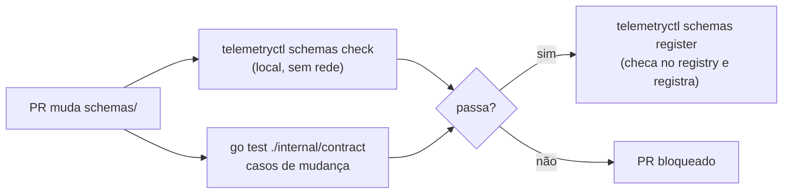

# Roteiro: contratos de schema

Como os produtores (gateways das estufas e simulador), o agregador, o Kafka Connect e o data lake concordam sobre o formato das mensagens, e como uma mudança de schema é impedida de quebrar alguém.

## 1. A solução

- **Formato**: Avro, com o Confluent Schema Registry e a TopicNameStrategy (`greenhouse.readings-value`, `greenhouse.aggregates-value`, `greenhouse.alerts-value`). ADR 0001.
- **Fonte da verdade no repositório**: `schemas/avro/` guarda todas as versões de cada subject; `schemas/catalog.go` lista a ordem. A última versão é a que os produtores usam.
- **Formato de fio**: `[0x00][id do schema, uint32 big-endian][payload Avro]` (`internal/contract/wire.go`).
- **Leitura de qualquer versão**: o decoder busca o schema do escritor pelo id, guarda em cache e decodifica num registro Go que conhece a versão mais nova. Campos que o escritor não tinha ficam com o valor zero (por isso campos novos precisam ser opcionais).
- **Compatibilidade**: BACKWARD no registry, BACKWARD_TRANSITIVE no CI. ADR 0004.
- **Registro controlado**: `telemetryctl schemas register` configura BACKWARD por subject, pergunta ao registry se cada versão é compatível e só então registra. Os produtores não registram schemas sozinhos (sem auto-register): só usam `Lookup` e falham se o schema não estiver registrado.

### Evolução já feita

`SensorReading` v1 → v2 adicionou `firmware_version: ["null", "string"]` com `default: null`. O agregador lê mensagens v1 e v2 (`TestDecodeReadsOlderWriterVersion`).

`sensor_type` é um enum com o símbolo `UNKNOWN` como `default` (Avro 1.9+): em bibliotecas que implementam o default de enum, como o cliente Java usado pelo Kafka Connect, um consumidor antigo que receba um símbolo novo lê `UNKNOWN` em vez de falhar. No agregador, `UNKNOWN` é um tipo inválido e a leitura vai para a DLQ.

## 2. O portão do CI

Casos cobertos por teste (`TestSchemaChangeCompatibility`):

| Mudança em `SensorReading` | BACKWARD | FORWARD | FULL |
| --- | --- | --- | --- |
| Adicionar campo opcional com default (v2) | passa | passa | passa |
| Adicionar campo obrigatório sem default | **falha** | passa | **falha** |
| Trocar `value` de `double` para `string` | **falha** | **falha** | **falha** |
| Remover o campo obrigatório `unit` | passa | **falha** | **falha** |

O pedido original era "remover um obrigatório falha". Em BACKWARD isso **não** falha: o leitor novo simplesmente ignora o campo que vem nos dados antigos. Quem quebra é o **consumidor antigo** lendo dados novos, ou seja, FORWARD. O teste documenta os dois lados, e o caso que falha em BACKWARD é o campo obrigatório novo sem default. O teste de integração (`TestRegistryEnforcesBackwardCompatibility`) confere que o registry real dá o mesmo veredito.

## 3. Alternativas consideradas

- **Protobuf**: tipagem gerada e evolução por número de campo. Avro venceu pela integração com Kafka Connect (JDBC e Parquet derivam do schema) e pela resolução leitor/escritor com defaults.
- **JSON Schema**: legível, mas maior e com regras de evolução mais fracas.
- **Auto-register no produtor**: cômodo, mas qualquer deploy de produtor muda o contrato sem revisão; preferimos registrar pelo pipeline.
- **Compatibilidade FULL**: protege também consumidores antigos, ao custo de exigir default em tudo e proibir remoções; candidata quando houver consumidores externos.

## 4. Trade-offs

- O registry entra no caminho de leitura (mitigado com cache e retry sem DLQ).
- A checagem local usa a biblioteca Avro do Go, mais estrita que o registry em alguns casos (enum com default). Por isso o registry é consultado de novo no registro: ele é a fonte da verdade.
- Strings no lugar de enums nos agregados e alertas facilitam o sink JDBC, mas perdem validação no contrato.

## 5. Perguntas que um entrevistador faria

**Por que BACKWARD e não FULL?**
Porque na telemetria os consumidores (agregador, Connect) são atualizados antes dos gateways. BACKWARD garante exatamente isso: o consumidor novo lê dados velhos. FULL obrigaria default em todos os campos e impediria remoções, um custo que só se paga com consumidores fora do nosso controle.

**Remover um campo é seguro então?**
Para o registry em BACKWARD, sim. Para consumidores antigos ainda rodando, não. A regra do time é deprecar primeiro (tornar opcional), esperar todos os consumidores migrarem e só depois remover.

**E se alguém mudar o tipo de um campo?**
O portão local falha no PR, e o registry recusa no registro. O caminho certo é um campo novo com outro nome e a deprecação do antigo.

**Por que BACKWARD_TRANSITIVE no CI se o registry está em BACKWARD?**
Porque o tópico pode ser relido do início (reprocessamento, novo consumidor). A versão nova precisa ler todas as anteriores, não só a última.

**Como um consumidor lê duas versões ao mesmo tempo?**
Pelo id no cabeçalho da mensagem: o decoder busca o schema do escritor e o Avro resolve para a estrutura do leitor. Campo que o escritor não tinha fica com o default.

**O que acontece com uma mensagem com id de schema que não existe?**
É definitiva: vai para a DLQ com o motivo `unknown_schema`. Já uma falha de conexão com o registry é transitória: retry, sem DLQ.

**Onde fica o contrato dos tópicos para outro time?**
No repositório (`schemas/avro/*.avsc`, com `doc` em cada campo) e no registry. O id do schema viaja em cada mensagem.
