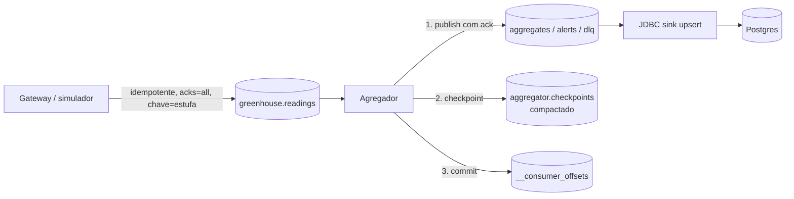

# Roteiro: garantias de entrega

Este roteiro explica, do produtor ao Postgres, por que nenhuma leitura se perde e nenhum agregado aparece duplicado ou parcial, mesmo com crash, rebalance e retransmissão. Serve para defender o desenho numa entrevista.

## 1. O problema em uma frase

Precisamos de "efeito exatamente uma vez" no painel da cooperativa usando um transporte que, por padrão, entrega "pelo menos uma vez".

## 2. A solução, ponta a ponta

### Produtor

| Configuração | Por quê |
| --- | --- |
| `acks=all` | O líder só confirma depois que as réplicas em sincronia gravaram. Com `min.insync.replicas=2` e RF=3, perder um broker não perde mensagem confirmada. |
| Idempotência (padrão no franz-go) | O broker guarda producer id + número de sequência por partição e descarta retransmissões. Retry de rede não duplica nem reordena. |
| Chave = `greenhouse_id`, particionador murmur2 | Todas as leituras de uma estufa caem na mesma partição, então chegam em ordem. É compatível com o cliente Java, então outro produtor em outra linguagem respeita a mesma distribuição. |

Idempotência do produtor não resolve retransmissão **da aplicação**: se o gateway reenvia a mesma leitura (porque não recebeu ack), é uma mensagem nova para o broker. Por isso existe o `event_id`.

### Consumidor (o núcleo)

Para cada lote retornado pelo poll:

1. Decodifica e valida cada leitura. Inválida vai para a DLQ com os bytes originais e headers de origem (`dlq.reason`, `dlq.source.offset`...).
2. Descarta duplicatas por `event_id` e leituras de janelas já fechadas.
3. Fecha as janelas cujo fim passou do watermark.
4. **Publica** DLQ, agregados e alertas e espera o ack de todos.
5. **Grava o checkpoint** de cada partição tocada: offset seguro + watermark.
6. **Commita** o offset seguro.

Se qualquer passo falha, o processo para sem commitar. O orquestrador reinicia, e a partição recomeça do último commit.

#### Offset seguro

Commitar o último offset processado perderia dados: as leituras de uma janela aberta estão só em memória. O offset seguro é o **menor primeiro-offset entre as janelas abertas** (ou o próximo offset, se não houver janela aberta). Depois de um crash, o consumo recomeça ali e reconstrói essas janelas.

#### Por que o checkpoint de watermark

Ao recomeçar do offset seguro, o consumidor relê também leituras de janelas que **já foram emitidas** (estão intercaladas com as abertas na mesma partição). Sem cuidado, ele reabriria essas janelas com só parte das leituras e emitiria um agregado parcial, que o upsert gravaria por cima do correto.

O checkpoint guarda o watermark do momento do commit. Ao restaurá-lo, toda leitura de janela com fim ≤ watermark é tratada como atrasada e descartada. Isso vale exatamente para as janelas já emitidas, e as janelas que estavam abertas não são afetadas, porque todas as leituras delas estão depois do offset seguro. Resultado: o reprocessamento emite **os mesmos agregados**, bit a bit (`TestReplayFromCheckpointIsDeterministic` e `TestRestartFromCheckpointDoesNotReemitClosedWindows`).

O franz-go não grava metadata no commit de offset, então o checkpoint vai para um tópico compactado (uma mensagem por partição). É a mesma ideia do changelog do Kafka Streams, reduzida ao essencial.

#### Por que a ordem publish → checkpoint → commit

| Crash depois de... | O que acontece no restart | Efeito |
| --- | --- | --- |
| processar, antes de publicar | Recomeça do commit anterior; nada foi emitido | Nenhum |
| publicar, antes do checkpoint | Recomeça do commit anterior com watermark anterior; reemite as mesmas janelas | Duplicata idêntica, absorvida pelo upsert |
| checkpoint, antes do commit | Commit anterior + watermark novo; leituras do intervalo pertencem a janelas já emitidas e são descartadas | Nenhum |
| commit | Estado consistente | Nenhum |

Se o checkpoint fosse gravado antes do publish, um crash no meio descartaria janelas que nunca chegaram ao tópico: perda de dados.

#### Rebalance

`BlockRebalanceOnPoll` impede rebalance no meio de um lote. No revoke, o agregador commita o offset seguro e descarta o estado das partições; o novo dono reconstrói as janelas abertas a partir do checkpoint. Partições *perdidas* (sessão expirou) são descartadas sem commit, porque outra instância pode já ser dona delas.

#### Erro transitório versus mensagem inválida

Mandar para a DLQ porque o Schema Registry caiu descartaria mensagens válidas. O decoder classifica:

- `ErrMalformed` (byte mágico errado, payload truncado) e `ErrUnknownSchema` (id inexistente): definitivos, vão para a DLQ.
- Qualquer outro erro do registry: transitório, retry com backoff exponencial até 5 s, bloqueando a partição.

### Sink

O JDBC sink faz upsert pela chave de negócio da janela (`greenhouse_id, sensor_type, window_start`) e pelo `alert_id`. Duplicatas idênticas viram updates sem efeito.

## 3. At-least-once + idempotência versus exactly-once transacional

| | At-least-once + idempotência (escolhido) | EOS transacional do Kafka |
| --- | --- | --- |
| Mecanismo | Commit depois do publish; saídas com id determinístico; upsert | `transactional.id`, `sendOffsetsToTransaction`, consumidores `read_committed` |
| Duplicatas no tópico de saída | Possíveis, idênticas | Não |
| Garantia no Postgres | Efeito exatamente uma vez (upsert) | Precisa de upsert do mesmo jeito: a transação não cobre o banco |
| Latência | Menor | Maior: consumidores esperam o commit da transação (LSO) |
| Complexidade operacional | Checkpoint e ids determinísticos | Coordenador de transação, fencing de produtores zumbis, `transactional.id` estável por partição |
| Quando preferir | Destinos fora do Kafka, saídas com chave natural | Pipelines Kafka → Kafka onde consumidores não toleram duplicata nem conseguem deduplicar |

A frase para a entrevista: **"exactly-once do Kafka é exactly-once dentro do Kafka; assim que o dado sai para um banco, quem garante é a idempotência do destino"**.

## 4. Alternativas consideradas

- **Commit automático**: pode commitar antes do processamento; perde dados.
- **Commit por registro**: correto, mas um round trip por mensagem derruba o throughput.
- **Estado em Redis/Postgres**: tira o estado da memória, mas acrescenta uma dependência no caminho quente e ainda exige coordenar o commit.
- **Kafka Streams/Flink**: resolvem janelas, estado e EOS prontos; custam JVM ou cluster próprio. Aqui o objetivo é dominar o mecanismo.

## 5. Trade-offs assumidos

- Leituras atrasadas além da tolerância (10 s) são descartadas e contadas, não corrigem o agregado já emitido.
- O tópico de checkpoint é relido inteiro a cada rebalance (é pequeno: uma mensagem por partição).
- Partição sem tráfego não avança o watermark e segura janelas.
- Uma falha de publish derruba o processo (fail-fast) em vez de tentar recuperar o estado em memória.

## 6. Perguntas que um entrevistador faria

**Por que não usar transações do Kafka e pronto?**
Porque o destino final é o Postgres, fora da transação. Eu precisaria de upsert de qualquer forma. As transações acrescentariam latência e complexidade (fencing, `transactional.id`) para proteger só o trecho Kafka → Kafka, que já é idempotente pelos ids determinísticos.

**O que acontece se o agregador morrer entre publicar os agregados e commitar?**
O novo dono recomeça do commit anterior e reemite os mesmos agregados, idênticos, porque o checkpoint garante que as janelas são reconstruídas inteiras ou descartadas. O upsert absorve.

**Por que o offset commitado fica "para trás"?**
Porque as leituras de janelas abertas existem só em memória. Commitar além delas perderia essas leituras num crash. O preço é reprocessar no máximo cerca de 1 minuto + tolerância de dados por partição.

**Produtor idempotente já não resolve duplicatas?**
Resolve as do retry do próprio produtor (mesma sessão, mesmo número de sequência). Não resolve o gateway que reenvia a leitura numa nova requisição, nem o reprocessamento do consumidor. Por isso há `event_id` e saídas idempotentes.

**Como você garante a ordem por estufa?**
Chave de partição = estufa e produtor idempotente (que mantém a ordem mesmo com várias requisições em voo por conexão). O consumidor processa cada partição em sequência. A janela usa tempo de evento, então pequenas inversões dentro da tolerância não importam.

**E se o Schema Registry cair?**
O consumidor usa o cache de schemas por id; para ids novos, entra em retry com backoff e para de avançar a partição. Nada vai para a DLQ por causa disso. O lag sobe e o alerta `AggregatorStalled` dispara.

**O que vai para a DLQ e como reprocessar?**
Bytes que não são Avro do registry, ids de schema inexistentes e leituras fora da faixa física. A mensagem guarda os bytes originais e a origem nos headers, então um job de reprocessamento pode corrigir e republicar no tópico de leituras.

**Como o rebalance não corrompe o estado?**
`BlockRebalanceOnPoll` só deixa o rebalance acontecer entre lotes. No revoke commitamos o offset seguro e descartamos o estado; o novo dono reconstrói pelo checkpoint.

**Qual é o custo de memória do deduplicador?**
Ele guarda ids só enquanto podem chegar duplicatas úteis: até o watermark passar de `measured_at + tamanho da janela`. Na prática, cerca de 1 a 2 minutos de ids por partição.
